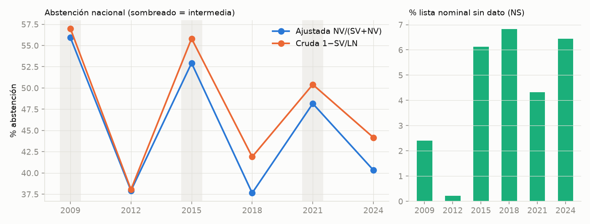
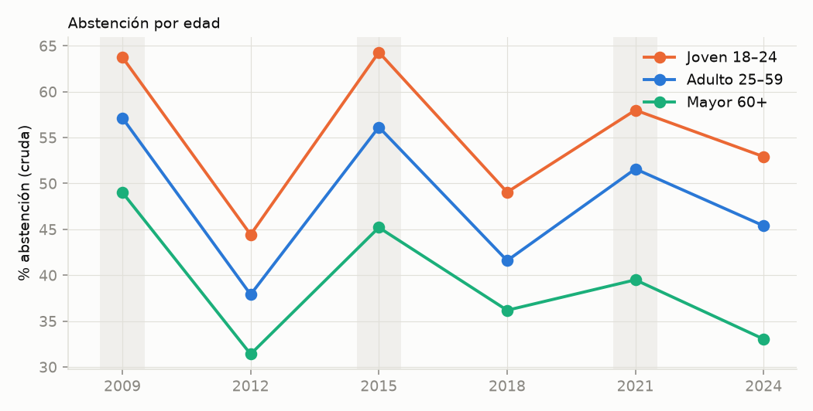
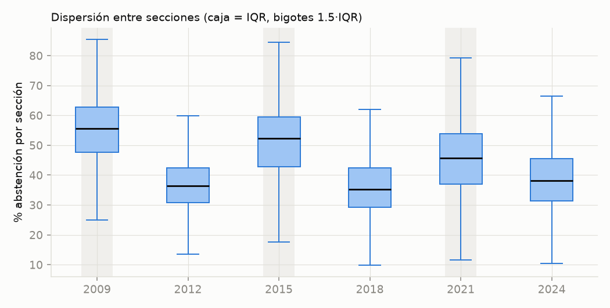
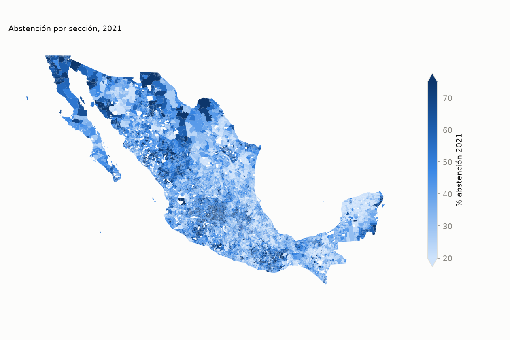
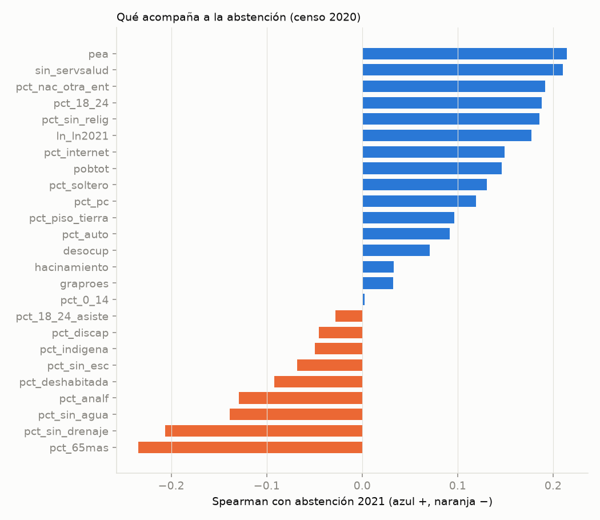
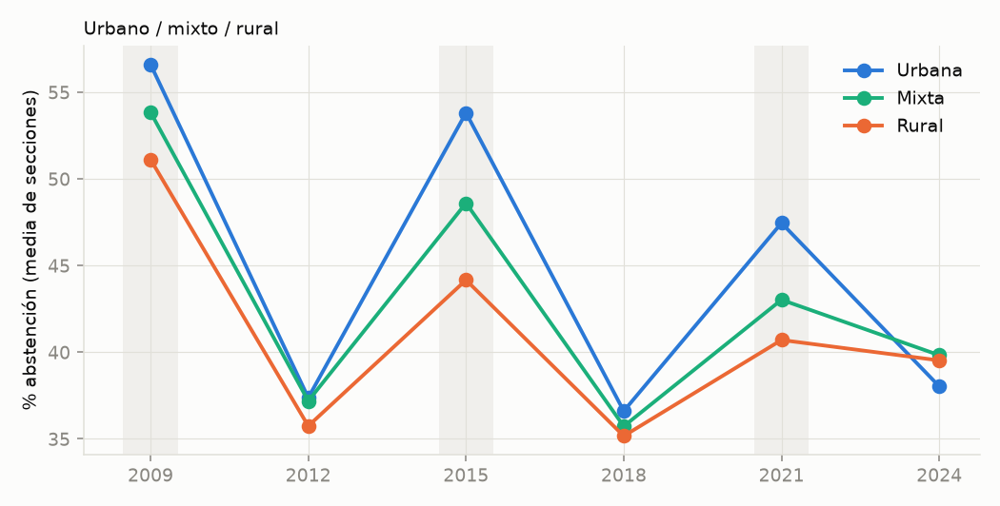
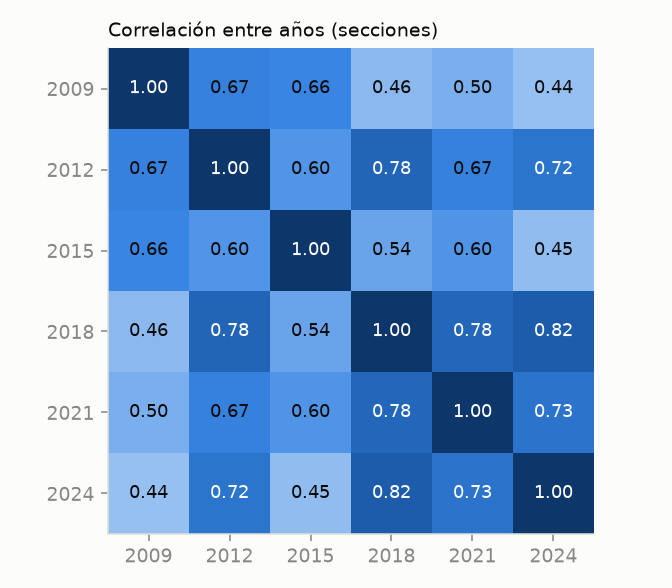

# EDA y storytelling: ¿dónde y cuándo no votan los mexicanos?

Datos: Conteos Censales de Participación INE 2009–2024 (lista nominal sección × sexo × edad), ECEG 2020 (INE-INEGI, 227 indicadores por sección) y marco seccional 2021. Todo reproducible con `download_data.py` → `build_panel.py` → `analysis/eda.py`. Cifras en `reports/eda_stats.json`.

**Definiciones.** *Abstención ajustada* = NV/(SV+NV): excluye los registros sin dato (NS, cuadernillos no capturados). *Cruda* = 1−SV/LN. Se usa la ajustada como variable objetivo porque la proporción de NS cambia entre elecciones (0.2% en 2012, 6.8% en 2018) y la cruda mezclaría un artefacto de captura con comportamiento.

---

## Capítulo 1. Dos países electorales: el ciclo manda

La abstención nacional no sigue una tendencia, sigue un **ciclo**: 55.9% (2009), 37.9% (2012), 52.9% (2015), 37.6% (2018), 48.2% (2021), 40.3% (2024). Las elecciones intermedias (2009, 2015, 2021) rondan 48–56%; las presidenciales, 38–40%. La presidencial arrastra a ~13–15 puntos más de personas a las urnas.

Consecuencia para el reto: **2027 es intermedia**. Un modelo que extrapole "el año anterior" (2024, presidencial) subestimaría la abstención. Los modelos deben tratar el nivel nacional por separado de la posición relativa de cada sección.

Dos matices de honestidad: (a) la brecha entre la métrica cruda y la ajustada llega a 4.3 pp en 2018 por el NS (panel derecho), así que comparar crudas entre años sesga; (b) las intermedias van **bajando** (55.9 → 52.9 → 48.2), señal de tendencia dentro del ciclo, pero con solo tres puntos no se puede estimar con confianza.

## Capítulo 2. Los jóvenes votan menos, y la brecha crece

La abstención juvenil (18–24, cruda) supera a la de 60+ en 13–20 pp en cada elección, y la brecha **máxima es 2024: 19.9 pp** (52.9% vs 33.0%). También hay brecha de sexo: en 2024 los hombres se abstienen 48.8% y las mujeres 39.9% (cruda). Esta es la palanca de política más natural del reto (movilización juvenil), aunque aquí es una asociación, no un efecto causal.

## Capítulo 3. La mitad de la historia es "dónde vives"

Entre secciones la abstención 2021 tiene un IQR de 16.9 pp. Es un patrón **geográfico**: la autocorrelación espacial (Moran's I, 8 vecinos más cercanos) es **0.71 en 2021** y 0.68–0.76 en las seis elecciones. Cada estado explica 22% de la varianza y cada **municipio 65%**. Buena parte de lo que parece "efecto de la sección" es efecto del municipio (política local, cacicazgos, violencia, tamaño de la ciudad). Estados con mayor abstención 2021: Baja California (59.9%), Durango, Guanajuato, Sonora, Quintana Roo; menor: Tlaxcala (31.9%), Yucatán, Campeche, Chiapas, SLP.

La señal de cambio también es espacial (Moran de la diferencia 2021−2015 = 0.72): los shocks son locales, no idiosincráticos de cada sección. Implicación: variables de vecindad deben ser candidatas fuertes de features.

## Capítulo 4. Lo que el censo NO explica

Contra la intuición, **la escolaridad casi no se relaciona** con la abstención (Spearman 0.03 con grado promedio de escolaridad). Las asociaciones más fuertes son modestas (|ρ| ≤ 0.24): más abstención donde hay más PEA, más población sin servicios de salud, más migrantes de otra entidad y más jóvenes 18–24; menos donde hay más adultos mayores (−0.23) y más carencias de drenaje y agua (−0.21, −0.14). Las secciones **rurales se abstienen menos** (40.7% en 2021) que las **urbanas** (47.5%).

Lectura: la participación en México se parece más a un fenómeno de integración comunitaria y estructura demográfica (jóvenes migrantes, trabajo, ciudades grandes) que de privación material. Ojo con la falacia ecológica: estas son correlaciones entre secciones, no entre personas.

## Capítulo 5. La mejor pista del futuro es el pasado cercano

La posición relativa de una sección es muy estable: la correlación 2021↔2018 es 0.78 y 2024↔2018 es 0.82; 2024↔2021 es 0.73. Sorprende que sea **mayor con la elección adyacente que con la del mismo tipo** (2021↔2015 es 0.60 y 2024↔2012 es 0.72). Hipótesis: cambios de cartografía y de captura en 2015 (NS 6.1%), y arrastre de clima político local. Esto marca el piso que cualquier modelo debe superar: **el rezago**. La pregunta científica no es "¿se puede predecir?" (sí, con el rezago), sino **"¿cuánto agregan las covariables, el espacio y los jóvenes sobre el rezago?"**. El benchmark y la ablación responden eso.

## Capítulo 6. Advertencias sobre los datos

- **Cobertura.** 72,681 secciones aparecen en algún año; solo 54,864 tienen las seis elecciones y ECEG completo. Las excluidas son más pequeñas (mediana de lista nominal 719 vs 1,150), probablemente rurales con datos censales suprimidos. El mapa (f08) usa las 67,119 con dato 2021. El modelado no exigirá el panel completo: exigirá solo los rezagos necesarios y tratará ECEG faltante explícitamente.
- **Cartografía cambiante.** El marco seccional es 2021; hay 70,751 secciones en 2024. Una sección puede cambiar de límites entre elecciones aun con el mismo número.
- **NS.** Se usa abstención ajustada; las métricas por edad no se pueden ajustar (NS no viene por edad), por lo que son crudas.
- **Valores extremos.** 17 secciones con abstención exactamente 0 o 1 en 2024, 68 con lista nominal < 100, y una sección de 40,865 electores (probable agregación). Se ponderará o filtrará en el benchmark y se reportará sensibilidad.
- **Covariables estáticas.** ECEG es 2020; para objetivos anteriores a 2020 es una covariable estructural, no contemporánea.
- **Cobertura del reto.** El INE/INEGI no publican la relación sección↔AGEB en estos insumos, así que las "AGEBs vinculadas" del enunciado requieren un cruce espacial adicional (no hecho aún).

## Qué sigue
Con este diagnóstico: (1) el objetivo es la **abstención relativa** y el nivel nacional se trata aparte; (2) la línea base seria es el rezago, no el promedio; (3) validar con **rolling-origin** (entrenar en pasado, probar en 2021 y 2024); (4) las grupos de features a probar son rezagos, censo, espacial/municipal, juventud/estructura.
